# DSM 2024 Settlement Engine

**A Functional Business Analyst case study for Indian power markets.**

I took one regulation, the **CERC (Deviation Settlement Mechanism and Related Matters) Regulations, 2024** (No. L-1/260/2021/CERC, 05 Aug 2024), along with its **three amendments** (in force 23-12-2024, 01-07-2025 and 31-08-2026), and did the full analyst job on it: stakeholders, process, a traceable rule catalogue, an amendment impact analysis, visual explanations of every rule, user stories, a clarification log, and a working settlement engine checked against hand-calculated test cases.

### ▶ [Open the live case study](https://ektasharma-github.github.io/dsm-2024-settlement-engine/)

It's a single HTML file with no build step and no external scripts. It also works offline: download `index.html` and open it in a browser.

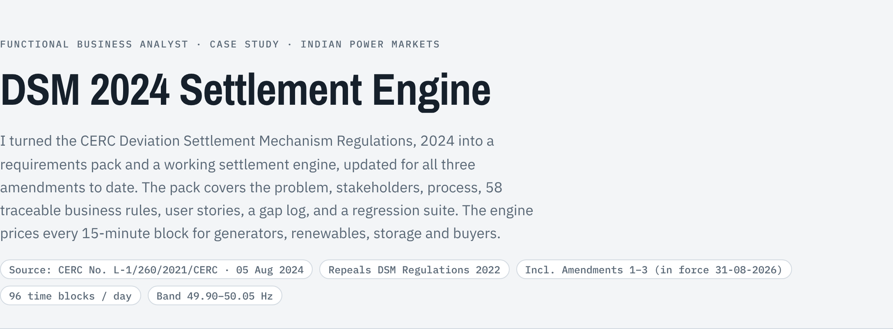

---

## The problem

Every grid-connected generator and buyer in India is scheduled in 15-minute blocks, 96 a day. Whenever actual metered energy differs from the schedule, the gap is a **deviation**. It's priced by grid frequency, by size of deviation and by entity type, then settled every week through the Regional Power Committee (RPC).

For forecasting, scheduling and QCA platforms, the client's DSM bill is the number that matters. The 2024 regulation brings in several changes:
- a new denominator for wind and solar plants from 01-04-2026
- new buyer categories for RE-rich states
- sign inversion for storage while it charges
- a repeal of the 2022 rules

CERC has since amended the regulation three times, so each block must be priced under the rule version in force on its date.

A product team needs a precise, testable spec of these rules before it can build forecasting, bidding or settlement-audit features. This project is that spec, plus a prototype that proves it.

## What's inside

| BA deliverable | In the live page |
|---|---|
| Problem statement, objectives, success measures, stakeholder map | **Context** |
| Weekly settlement cycle (RLDC → RPC → payment → late payment surcharge / LC) and process flowchart | **Process** |
| **58 business rules**, each traced to a clause and tagged Principal, amended or new (`BR-GS-01` … `BR-PY-03`) | **Business rules** |
| Amendment change control: effective-date timeline, impact analysis, infirm-power rule history, WS parity checker | **Amendments** |
| Every rule drawn as a chart or diagram, with hover readouts and a table view | **Rules, visually** |
| Single-block calculator for every entity type, plus normal-rate and late-payment-surcharge calculators | **Calculator** |
| 96-block day simulator with CSV upload, chart and product insights | **Day simulator** |
| **23 hand-calculated test cases**, including both sides of every amendment date, run live in the page and from the command line | **Test suite** |
| User stories with Given/When/Then acceptance criteria, prioritised Must / Should / Could | **User stories** |
| **18 ambiguities** in the regulation and its amendments, each with a working assumption and an impact rating | **Clarification log** |
| Data inputs and sources, non-functional requirements, phased roadmap | **Data & delivery** |

## Amendments: change control

Each amendment is captured as an effective-dated rule. A block is priced under the version in force on its date, and each charge line names the rule (and amendment) that produced it.

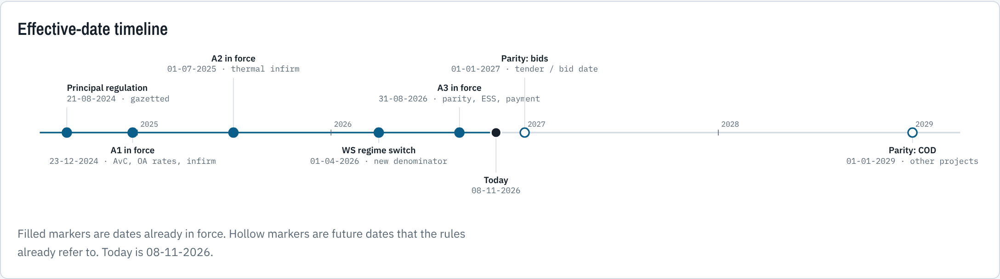

| Amendment | In force | What changed | Rules |
|---|---|---|---|
| First (2024) | 23-12-2024 | Available capacity capped at connectivity granted; third-party open access sellers priced at the IDAM price; scheduled infirm over-injection above 50.05 Hz is zero | BR-DV-05, BR-RT-01/02, BR-IF-05 |
| Second (2025) | 01-07-2025 | Infirm-power clause rewritten: thermal units paid at NR, capped at ₹2.86/kWh, from first sync to trial run; all infirm injection above 50.05 Hz is zero | BR-IF-01/02/04/05 |
| Third (2026) | 31-08-2026 | New wind/solar projects priced as general sellers (bid ≥ 01-01-2027 or COD ≥ 01-01-2029); storage infirm power paid at NR, capped at ₹2.00/kWh; Section 62 pumped hydro at the energy charge rate; payment timeline can follow the national pool procedure | BR-WS-05, BR-IF-03, BR-ES-04, BR-PY-01/03 |

**Infirm power** changed in every amendment. The matrix shows each case under each version, with outlines where the outcome changed.

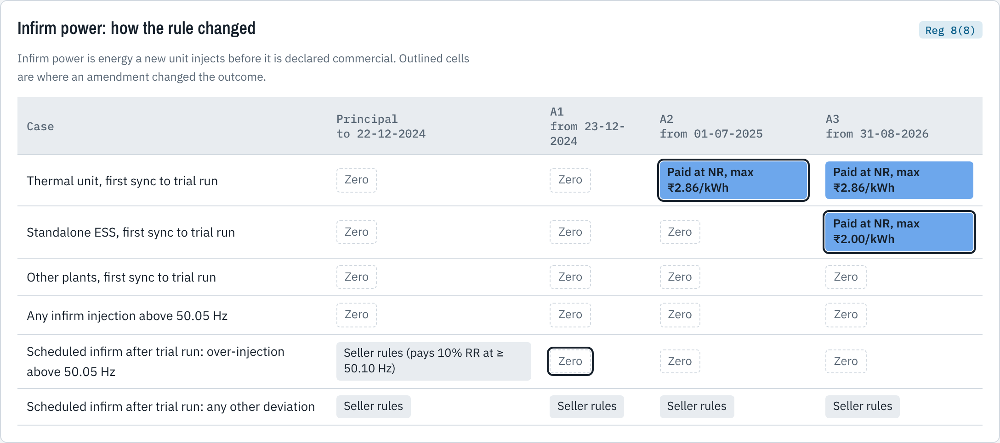

**Wind/solar parity** (Third Amendment, Reg 8(4A)) moves new projects from volume-linked pricing to the frequency-linked general-seller table. The checker tells you whether a project is affected. The chart shows what parity does to the same 10 MW shortfall: it's cheaper at normal frequency (100% of contract rate against 124%) but dearer when the grid is short (170% below 49.90 Hz). That makes forecast error most expensive exactly when frequency is low.

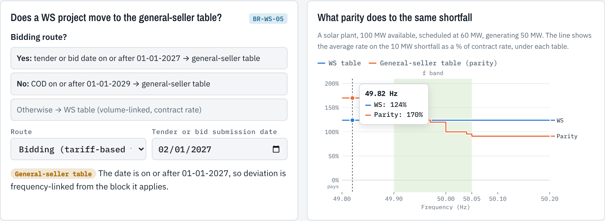

## The rules, visually

The charts are drawn by the same functions that price the calculator, so the pictures and the numbers can't disagree.

**Which table prices my deviation?** This map runs from entity type to the pricing table that applies, including special-case overrides and the amended rules.

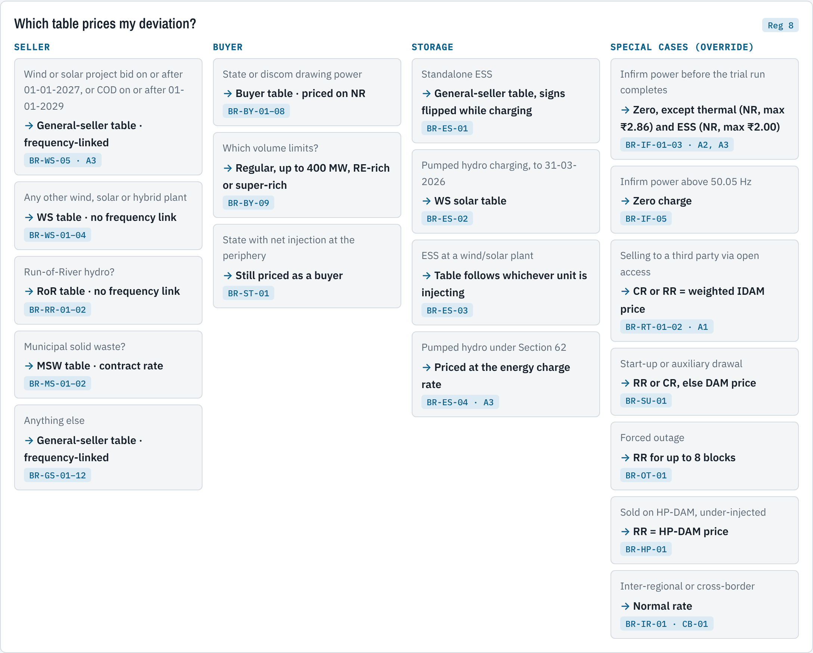

**Frequency-linked pricing.** These charts show the rate a general seller receives or pays across grid frequency, with the 49.90–50.05 Hz operating band shaded. Falling short at low frequency costs up to 200% of the reference rate. Over-injection above 50.10 Hz costs the seller money. Matching charts for buyers cover each volume slab.

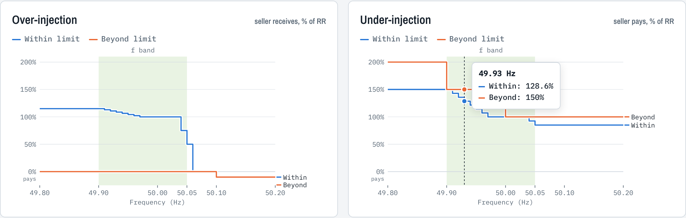

**Volume-linked pricing.** These bars show the rate steps for wind, solar, Run-of-River and MSW plants, and compare the rules to 31-03-2026 with the rules from 01-04-2026.

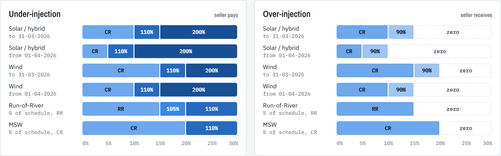

The section also covers:
- how the 01-04-2026 denominator change raises the cost of one example block from ₹6,250 to ₹7,750
- buyer volume limits by category
- storage sign inversion while charging
- the 8-block forced-outage window
- money flows through the pool account

## The working prototype

**Settlement process.** From schedules and meter data to the block-wise ledger and the check against the RPC statement.

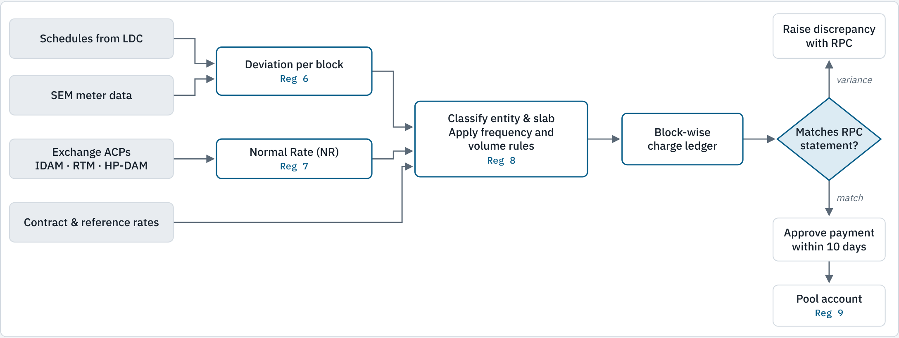

**Single-block calculator.** Every charge line shows its volume slab, rate and the rule ID that produced it. The block date, connectivity, project route and infirm-power status apply the amendments automatically, and the calculator lists each one it applied.

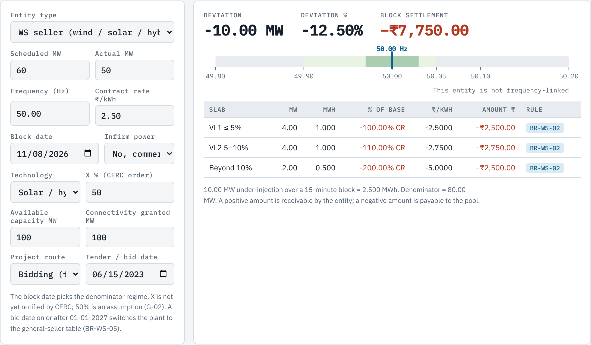

**Day simulator.** Prices 96 blocks and turns the result into product insights. On the sample day, 10% of blocks carry most of the cost, which argues for spending forecasting effort on volatile periods.

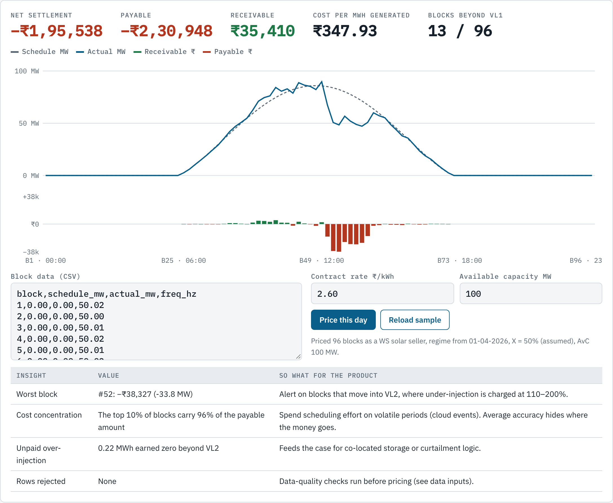

## Quality: a regression suite worked out by hand

Each expected value was calculated by hand from the clause, independently of the code. Amendment cases test both sides of each effective date (for example, thermal infirm power on 01-05-2025 against 01-08-2025). The page runs every case when it loads, so a rule change that breaks one shows as FAIL.

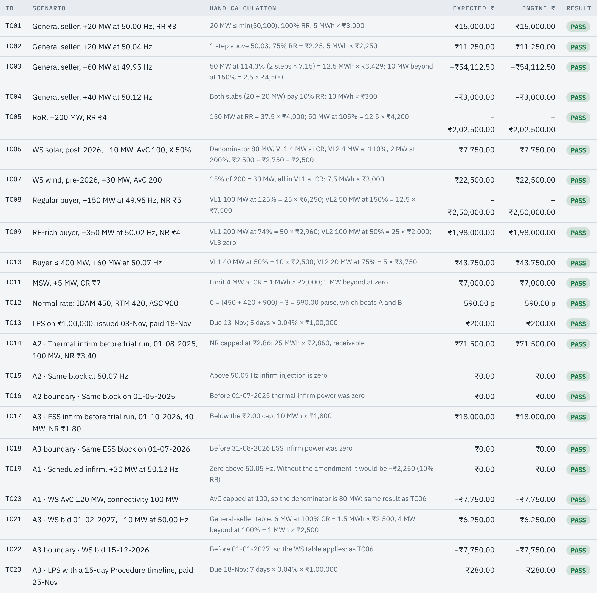

To run the suite from the command line:

```bash
node tests/engine.test.js
```

## Selected findings from the clarification log

| ID | Finding | Working assumption |
|---|---|---|
| G-01 | "10% D<sub>GS</sub> or 100 MW". D<sub>GS</sub> is defined as the deviation itself, so the literal reading is circular. | Limit = min(10% × schedule, 100 MW) |
| G-02 | The weighting *X* in the wind/solar denominator from 01-04-2026 hasn't been notified yet. | Dated configuration, placeholder 50% |
| G-04 | Step rates miss the stated end points: 7 × 2.15% = 15.05% (115% stated), 7 × 7.15% = 50.05% (150% stated). | Apply the step, cap at the stated end point |
| G-06 | A buyer with exactly 400 MW scheduled fits two volume-limit categories. | Treat ≤ 400 MW as the small-buyer category |
| G-08 | The 8-block outage window has no defined start event. | Start from the outage declaration to the RLDC |
| G-13 | The Third Amendment puts new wind/solar "charges" at par with general sellers but doesn't say whether the deviation formula and rate basis also switch. | Apply the general-seller table in full, priced at the contract rate |
| G-14 | Parity cut-off names "tendering or bid submission dates", which can fall either side of 01-01-2027. | Use the bid submission date; flag projects that straddle it |
| G-16 | Payment can now follow the national pool account's Detailed Procedure, which isn't published in these documents. | Due-day count as configuration, default 10 |

All 18 are in the live page.

## Entities covered

- General seller
- Standalone storage (ESS), including pumped hydro
- Run-of-River hydro
- Municipal solid waste (MSW) plant
- Wind, solar and hybrid sellers under both regimes (to 31-03-2026 and from 01-04-2026), including QCA pooling
- Buyers: regular, up to 400 MW, RE-rich state, RE super-rich state
- Special cases: infirm power (by plant type and lifecycle stage), start-up power, forced outage, HP-DAM, third-party open access, inter-regional, cross-border

## Skills demonstrated

- **Regulatory analysis:** turning legal text into atomic, testable business rules with clause traceability
- **Change control:** impact analysis of three amendments, effective-dated rules, regression tests on both sides of each date
- **Requirements engineering:** BRD-style context, stakeholder analysis, user stories with acceptance criteria, NFRs, data requirements
- **Gap analysis:** finding contradictions, undefined terms and edge cases before development, with recommended assumptions
- **Process modelling:** an as-is weekly settlement cycle and a to-be audit flow
- **Test design:** an independent test oracle and boundary cases (frequency band edges, slab limits, regime change)
- **Data visualisation:** turning rate tables into charts that stakeholders can read
- **Prototyping:** a working engine that proves the spec is complete and unambiguous

## Repository structure

```
index.html            Live case study and prototype (engine inlined, no dependencies)
src/engine.js         Settlement engine: pure functions, runs in Node and the browser
tests/engine.test.js  Hand-calculated regression suite
docs/                 Source regulation, First/Second/Third Amendments, README screenshots
```

## Conventions

- A positive amount is **receivable** by the entity. A negative amount is **payable** to the Deviation and Ancillary Service Pool Account.
- Each time block is 15 minutes, so MWh = MW × 0.25.
- RR = reference charge rate, CR = contract rate (both ₹/kWh). NR = normal rate (paise/kWh, converted internally).

---

*This is a portfolio work sample, not legal or commercial advice. The day simulator uses synthetic data.*
